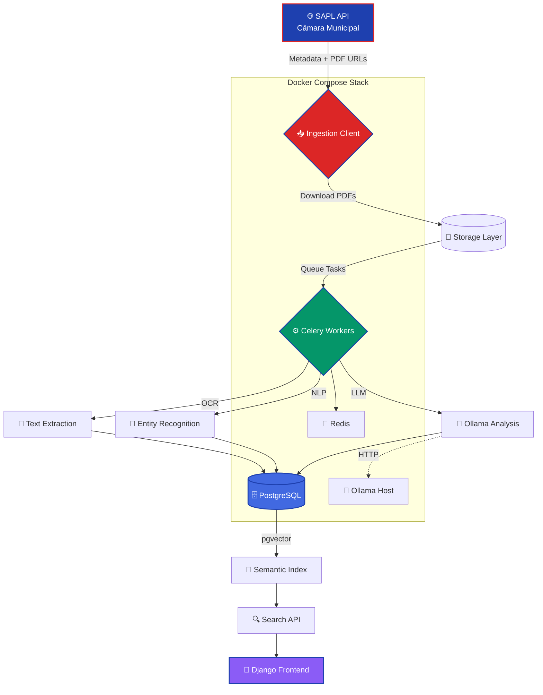

<div align="center">
  
  
  <h1>
    
  </h1>
  
  <samp>PIBIC/UFRN · Sistema de Consolidação Normativa e Rastreabilidade Jurídica</samp>
  <br/><br/>
  
  
  
  
  
  
</div>

<br/>

## `> system.overview()`

```python
class Jurix:
    def __init__(self):
        self.name = "Jurix"
        self.tagline = "Sistema de Consolidação Normativa e Rastreabilidade Jurídica Inteligente"
        self.scope = "Legislação Municipal de Natal/RN"
        self.institution = "UFRN"
        self.program = "PIBIC"
        self.python_version = "3.12+"
    
    def architecture(self):
        return {
            "backend": "Django 5.2 LTS",
            "database": "PostgreSQL 16 + pgvector",
            "ai_engine": "Ollama (llama3 via host)",
            "task_queue": "Celery + Redis",
            "frontend": "Django Templates + CSS + JavaScript modular",
            "deployment": "Docker Compose + WSL 2"
        }
    
    def capabilities(self):
        return [
            {"feature": "Consolidação Normativa", "icon": "📋"},
            {"feature": "Rastreabilidade Jurídica", "icon": "🔍"},
            {"feature": "Ingestão Automatizada (SAPL)", "icon": "📥"},
            {"feature": "OCR + NLP Processing", "icon": "🧠"},
            {"feature": "Vetorização Semântica", "icon": "🎯"},
            {"feature": "Chatbot RAG", "icon": "💬"}
        ]
    
    def differentiators(self):
        return [
            "Integração SAPL: Cliente API para câmaras municipais",
            "pgvector: Busca semântica em legislação",
            "Ollama Local: IA sem dependência de APIs externas",
            "Celery Pipeline: Processamento assíncrono em larga escala",
            "Docker-first: Deploy reproduzível em qualquer ambiente",
            "OCR Inteligente: Extração de texto de PDFs legados"
        ]
```

<br/>

## `> tech_stack`

<div align="center">
  
</div>

<table align="center">
<tr>
<td align="center" width="33%">
<strong>🎯 Backend & Database</strong><br/><br/>


</td>
<td align="center" width="33%">
<strong>🤖 AI & Processing</strong><br/><br/>


</td>
<td align="center" width="33%">
<strong>⚡ Infrastructure</strong><br/><br/>


</td>
</tr>
</table>

<br/>

## `> architecture_flow`

<div align="center">



</div>

<br/>

## `> project_structure`

```
jurix/
│
├── 🐳 docker/
│   └── Dockerfile                  # Multi-stage build (Python 3.12, OCR, Poppler, Curl)
│
├── ⚙️ config/
│   ├── settings.py                 # Configurações Django unificadas (Database, Redis, Ollama, Celery)
│   ├── urls.py                     # Roteamento global de URLs
│   ├── wsgi.py                     # Entrypoint WSGI Gunicorn
│   └── celery.py                   # Configuração do Celery worker/broker
│
├── 📦 src/
│   ├── apps/
│   │   ├── core/                   # Utilitários, modelos base e assets estáticos
│   │   │   ├── static/             # Swiss Design CSS, vendor local JS (marked, DOMPurify) e chat.js
│   │   │   └── models.py           # TimeStampedModel base
│   │   │
│   │   ├── legislation/            # Domínio jurídico e RAG
│   │   │   ├── models.py           # Norma, Dispositivo, ChatSession, ChatMessage
│   │   │   ├── views.py            # NormaListView, NormaDetailView, ChatbotView
│   │   │   ├── serializers.py      # Serialização desacoplada de dispositivos e sessões
│   │   │   ├── api_views.py        # Endpoints REST (Busca, RAG SSE Streaming, Health)
│   │   │   ├── api_urls.py         # Rotas /api/v1/
│   │   │   └── admin.py            # Django Admin customizado
│   │   │
│   │   └── ingestion/              # Ingestão e pipeline assíncrono
│   │       ├── models.py           # IngestionTask, RawDocument
│   │       └── tasks.py            # Tarefas Celery atômicas (download, OCR, segmentação)
│   │
│   ├── clients/
│   │   └── sapl/
│   │       └── sapl_client.py      # Cliente HTTP SAPL com URL configurável
│   │
│   ├── processing/
│   │   ├── legal_parser.py         # Segmentação hierárquica (Artigos, Parágrafos, Macro-divisões)
│   │   ├── ner_extractor.py        # Extração de referências jurídicas e entidades
│   │   ├── consolidation_engine.py # Motor de rastreamento de vigência e revogações
│   │   └── rag_service.py          # RAG Service, pgvector Cosine similarity e streaming
│   │
│   ├── llm_engine/
│   │   ├── ollama_service.py       # Ollama Service (Connection Pooling, Embeddings, SSE Stream)
│   │   └── prompts.py              # Templates de prompts para assistente jurídico
│   │
│   └── tests/                      # Suite de testes unitários e de integração
│       ├── conftest.py
│       ├── test_legal_parser.py
│       ├── test_models.py
│       ├── test_views.py
│       ├── test_api.py
│       └── ...
│
├── 📊 data/                        # Dados locais (não versionados)
│   ├── pdfs/                       # PDFs baixados do SAPL
│   └── media/                      # Uploads de documentos
│
├── 🔐 .env.example                 # Variáveis de ambiente de referência
├── 🐳 docker-compose.yml           # Stack: jurix_web, jurix_worker, jurix_db, jurix_redis
├── 📜 pyproject.toml               # Configuração do Ruff (Python 3.12) e metadados
├── 🧪 pytest.ini                   # Configurações do Pytest (Django, coverage)
├── 📦 requirements.txt             # Dependências de produção e qualidade
├── 📝 manage.py                    # Django CLI
├── 📄 LICENSE                      # Licença MIT
└── 📖 README.md
```

<br/>

## `> installation`

### Prerequisites

<table align="center">
<tr>
<td align="center">
<br/>
<samp>Docker Desktop + WSL 2</samp>
</td>
<td align="center">
<br/>
<samp>Ollama com modelo llama3</samp>
</td>
<td align="center">
<br/>
<samp>Python 3.12+ (dev local)</samp>
</td>
<td align="center">
<br/>
<samp>Provido via Docker</samp>
</td>
</tr>
</table>

### Quick Start

O caminho recomendado para explorar o protótipo é o perfil isolado de QA. Ele usa a porta `8287`, banco/Redis próprios e não lê seu `.env`:

```powershell
$env:JURIX_BUILD_VERSION = 'local-qa'
$env:JURIX_BUILD_REVISION = (git rev-parse --short HEAD).Trim()

docker compose -p jurix-normative-qa -f docker-compose.audit.yml up -d --build db redis web worker
docker compose -p jurix-normative-qa -f docker-compose.audit.yml exec -T web python manage.py migrate --noinput
docker compose -p jurix-normative-qa -f docker-compose.audit.yml ps
Invoke-WebRequest http://127.0.0.1:8287/api/v1/health/ready/
docker compose -p jurix-normative-qa -f docker-compose.audit.yml exec -T worker celery -A config inspect ping --timeout=5
```

Abra `http://127.0.0.1:8287/assistente/?new=1` e escolha **Acervo documental (em revisão)** para pesquisar PDFs candidatos. A demonstração de relações da LC 258/2024 fica em `http://127.0.0.1:8287/explorar/demo-consolidacao/`. Um QA recém-criado não contém os PDFs locais: os resultados vistos nesta máquina dependem do volume e dos documentos que foram preparados localmente. A página de demonstração pode ser explorada sem tomar os relacionamentos como conclusões jurídicas.

O endpoint de prontidão deve confirmar banco, pgvector, Redis e migrations. Ollama/corpus podem aparecer como `skipped`; isso não confirma geração nem cobertura documental. O worker deve responder `pong`, o que confirma disponibilidade do processo, não a conclusão de uma tarefa. Para interromper serviços sem apagar os volumes QA:

```powershell
docker compose -p jurix-normative-qa -f docker-compose.audit.yml stop
```

<br/>

## `> development_workflow`

### Comandos Essenciais

```powershell
# 🔄 Perfil QA isolado
docker compose -p jurix-normative-qa -f docker-compose.audit.yml ps
docker compose -p jurix-normative-qa -f docker-compose.audit.yml logs --tail 100 web worker
docker compose -p jurix-normative-qa -f docker-compose.audit.yml exec -T worker celery -A config inspect active_queues

# 🧪 Suíte Python do checkout atual (os testes são excluídos da imagem de runtime)
$workspacePath = (Get-Location).Path
docker compose -p jurix-normative-qa -f docker-compose.audit.yml run --rm --no-deps --volume "${workspacePath}:/workspace:ro" --workdir /workspace web python -m pytest -p no:cacheprovider -q src/tests/
```

### Desenvolvimento Python local (alternativa)

As dependências da aplicação estão em `requirements.txt`; `pyproject.toml` configura ferramentas e testes, mas atualmente não declara as dependências de runtime. No PowerShell:

```powershell
py -3.12 -m venv .venv
.\.venv\Scripts\python.exe -m pip install -r requirements.txt
```

Não aponte o ambiente QA para um banco de produto. Não use `migrate`, `makemigrations`, shell administrativo ou ingestão no perfil de produto para reproduzir esta demonstração. Os PDFs QA e as extrações locais não são publicados com o repositório.

<br/>

## `> sprint_roadmap`

<div align="center">

### 📋 Sprint 1: Infraestrutura Base


</div>

<table align="center">
<tr>
<td align="center"><strong>Task</strong></td>
<td align="center"><strong>Status</strong></td>
<td align="center"><strong>Priority</strong></td>
</tr>
<tr>
<td align="center">🐳 Docker Compose Setup</td>
<td align="center">✅ Completo</td>
<td align="center">🔴 Alta</td>
</tr>
<tr>
<td align="center">🗄️ PostgreSQL + pgvector</td>
<td align="center">✅ Completo</td>
<td align="center">🔴 Alta</td>
</tr>
<tr>
<td align="center">⚙️ Celery + Redis</td>
<td align="center">✅ Completo</td>
<td align="center">🔴 Alta</td>
</tr>
<tr>
<td align="center">🤖 Ollama Integration</td>
<td align="center">✅ Completo</td>
<td align="center">🔴 Alta</td>
</tr>
<tr>
<td align="center">📦 Models (Core + Legislation)</td>
<td align="center">✅ Completo</td>
<td align="center">🔴 Alta</td>
</tr>
<tr>
<td align="center">🌐 Cliente SAPL API</td>
<td align="center">✅ Completo</td>
<td align="center">🔴 Alta</td>
</tr>
<tr>
<td align="center">📥 Ingestão de normas</td>
<td align="center">✅ Completo</td>
<td align="center">🔴 Alta</td>
</tr>
<tr>
<td align="center">📄 OCR Pipeline</td>
<td align="center">✅ Completo</td>
<td align="center">🟡 Média</td>
</tr>
</table>

### 🚀 Sprint 2-3: IA e RAG

<div align="center">


</div>

<table align="center">
<tr>
<td align="center"><strong>Task</strong></td>
<td align="center"><strong>Status</strong></td>
</tr>
<tr>
<td align="center">🎯 Busca Semântica (pgvector)</td>
<td align="center">✅ Completo</td>
</tr>
<tr>
<td align="center">💬 Chatbot RAG (Ollama + Llama3)</td>
<td align="center">✅ Completo</td>
</tr>
<tr>
<td align="center">🔍 Segmentação Hierárquica (Multiline Fix)</td>
<td align="center">✅ Completo</td>
</tr>
<tr>
<td align="center">📊 Embeddings Vetoriais</td>
<td align="center">✅ Completo</td>
</tr>
<tr>
<td align="center">🎨 Shell compartilhado e tokens de interface</td>
<td align="center">✅ Completo</td>
</tr>
<tr>
<td align="center">⌨️ Command Palette (⌘K)</td>
<td align="center">✅ Completo</td>
</tr>
<tr>
<td align="center">🌓 Dark/Light Theme System</td>
<td align="center">✅ Completo</td>
</tr>
<tr>
<td align="center">♿ Acessibilidade WCAG 2.2 AA</td>
<td align="center">🟡 Em validação; conformidade não declarada</td>
</tr>
</table>

### 📊 Status Atual do Projeto

<div align="center">

**Atualizado em 18/10/2026 — protótipo de pesquisa; corpus e grafo normativo ainda em validação.** A base Django/PostgreSQL/pgvector e os fluxos de pesquisa continuam sendo a fundação do produto. O ciclo atual acrescenta ingestão documental rastreável, revisão humana de metadados e eventos, identidade normativa, versões temporais, relações jurídicas explícitas e expansão experimental do RAG. A entrada no acervo documental pode ser escolhida por conversa, enumerações explicitamente pareadas usam uma gramática conservadora e a página demonstrativa agora recolhe cadeias secundárias, mantendo navegação direta para o grafo e os cotejos. Estes fluxos têm regressões automatizadas e smoke local de QA; isso não constitui adjudicação jurídica nem avaliação com procuradores.

O código e os testes técnicos não equivalem a um corpus juridicamente validado. No QA isolado em 18/10, há **6.662 PDFs válidos**: 1.382 extrações técnicas completas, 8 parciais e 5.272 sem extração; documentos e extrações continuam pendentes, sem aceitação ou promoção. Restam 940 páginas adiadas pelo orçamento OCR nos oito documentos parciais. Os lotes recentes foram registrados no mapa de páginas como OCR tentado; o status parcial corresponde ao backlog ainda não processado, não a uma conclusão de ilegibilidade dessas páginas. Esses totais pertencem somente à instância QA local, não representam o banco de produto nem o universo de normas municipais. “Extração completa” descreve processamento técnico, não fidelidade do texto, identidade aprovada, vigência ou cobertura legislativa. O uso de relações no RAG permanece opt-in e depende de relações revisadas e evidência textual suficiente. Resultados científicos ficam **não avaliados** até existir amostra municipal adjudicada por pessoas — o gate definido no protocolo é de pelo menos 20 normas-piloto humanas.

Em 18/10/2026, a fila técnica de consulta ao catálogo SAPL percorreu **1.390/1.390 correspondências**, com 1.308 itens novos, 82 já existentes e zero falhas de tentativa. Essa fila é distinta do checkpoint de extração do corpus e não significa que os 6.671 PDFs foram processados cronologicamente. Documentos e extrações seguem pendentes, sem vínculo, aceite ou promoção. Uma comparação QA somente-leitura em três PDFs reais mediu correspondências textuais de células tabulares candidatas e não encontrou tabelas semânticas no HTML do Poppler; a amostra é pequena e não justifica trocar o extrator nem valida tabelas juridicamente. Consulte o [diário de progresso](docs/archive/progress/NORMATIVE_IMPLEMENTATION_PROGRESS.md) e o [relatório multiamostra](docs/research/evidence/review-20261018/pdf-layout-benchmark-multisample-20261018.md) para universos, comandos, resultados por lote e limitações; não interprete processamento técnico como cobertura legislativa.

O volume de normas e dispositivos depende do corpus configurado localmente; consulte a tela **Normas** ou a API para os totais atuais. Veja [`docs/archive/progress/NORMATIVE_GRAPH_DELIVERY.md`](docs/archive/progress/NORMATIVE_GRAPH_DELIVERY.md) para escopo e [`docs/research/NORMATIVE_GRAPH_OPERATIONS.md`](docs/research/NORMATIVE_GRAPH_OPERATIONS.md) para validação e ativação controlada.

Para contribuir sem confundir extração técnica com revisão jurídica, consulte [`CONTRIBUTING.md`](CONTRIBUTING.md).

#### Perfil local de demonstração QA (Docker)

O perfil de demonstração isolada usa PostgreSQL/Redis próprios, armazenamento QA separado e a porta `8287`. No PowerShell, a partir da raiz do repositório:

```powershell
docker compose -p jurix-normative-qa -f docker-compose.audit.yml up -d --build db redis web worker
docker compose -p jurix-normative-qa -f docker-compose.audit.yml exec -T web python manage.py migrate --noinput
docker compose -p jurix-normative-qa -f docker-compose.audit.yml ps
```

Abra `http://127.0.0.1:8287/`. Para parar sem remover os volumes QA, use `docker compose -p jurix-normative-qa -f docker-compose.audit.yml stop`. Esse perfil não é produção: o acervo permanece candidato, sem revisão/aceitação jurídica, e não deve ser promovido automaticamente ao corpus de produto. O assistente com Ollama também requer o serviço local configurado e acessível pelo Docker.

**Verificação local mais recente (18/10/2026):** o perfil Docker QA `:8287` passou pelo smoke Chromium com 34 verificações: 33 passaram, zero falharam e o RAG de projetos de lei ficou deferred por estar fora do escopo. O painel de instância confirmou versão QA explícita. As suítes focadas de ficha temporal/grafo/exportação/rotas passaram com **162 testes**; as regressões de recuperação/contexto passaram com **234 testes**. `manage.py check` passou. Um dump QA de 47,6 MB foi verificado e restaurado em PostgreSQL descartável com contagens de migrações e normas coincidentes; isso não ensaia restore do banco de produto. Esses números não são a suíte integral e não representam teste em produção, revisão jurídica ou estudo com procuradores. A captura da demonstração registra cerca de 4,8 mil CSS px de conteúdo inicial a 1280×900, com cadeias secundárias recolhidas e atalhos para expandi-las. O servidor local de QA `:8291` é independente; nenhuma dessas portas deve ser presumida como a instância de produto aberta pelo usuário. Para limites e evidências, veja [`docs/archive/progress/PGM_PILOT_DELIVERY.md`](docs/archive/progress/PGM_PILOT_DELIVERY.md), [`docs/research/PGM_USABILITY_RESULTS.md`](docs/research/PGM_USABILITY_RESULTS.md) e o diário abaixo.

</div>

### 🎨 Release 1.1.0 - Swiss Design UI/UX

**Lançado:** Janeiro 2025  
**Principais Melhorias:**
- Sistema de Design completo baseado em Swiss Design
- Interface chatbot modernizada (workspace layout, input transparente estilo Gemini)
- Command Palette para navegação rápida
- Theme system (dark/light mode)
- Melhorias de acessibilidade implementadas; conformidade WCAG 2.1 AA ainda não foi auditada formalmente
- Animações suaves e profissionais
- Copy response button (Markdown clipboard)
- Suporte a Markdown em perguntas do usuário

### Próximas Etapas

<table align="center">
<tr>
<td align="center" width="50%">
<strong>🧠 Qualidade da pesquisa jurídica</strong><br/><br/>
<samp>
• Validar cobertura, grounding e citações<br/>
• Exercitar PostgreSQL, Redis e Celery em QA<br/>
• Revisar eventos temporais com fonte oficial<br/>
• Medir recuperação com benchmark jurídico
</samp>
</td>
<td align="center" width="50%">
<strong>🚀 Preparação operacional</strong><br/><br/>
<samp>
• Completar testes de acessibilidade manual<br/>
• Medir desempenho em ambiente representativo<br/>
• Fechar gates de segurança e operação<br/>
• Avaliar prontidão antes de qualquer deploy
</samp>
</td>
</tr>
</table>

<br/>

## `> key_features`

<table align="center">
<tr>
<td align="center" width="20%">
<strong>💬 Chatbot RAG</strong><br/><br/>
<samp>
Assistente jurídico com <strong>RAG (Retrieval-Augmented Generation)</strong> usando Llama3 local. Responde perguntas sobre legislação com citações precisas.
</samp>
</td>
<td align="center" width="20%">
<strong>🔍 Busca Semântica</strong><br/><br/>
<samp>
pgvector + embeddings para busca por <strong>similaridade conceitual</strong>, não apenas palavras-chave.
</samp>
</td>
<td align="center" width="20%">
<strong>📋 Consolidação</strong><br/><br/>
<samp>
Rastreamento automático de <strong>alterações, revogações e vigência</strong> de normas municipais.
</samp>
</td>
<td align="center" width="20%">
<strong>⚡ Processamento Assíncrono</strong><br/><br/>
<samp>
Celery workers para <strong>ingestão massiva</strong> de PDFs sem bloquear interface.
</samp>
</td>
<td align="center" width="20%">
<strong>🤖 IA Local</strong><br/><br/>
<samp>
Ollama local por padrão; geração também pode usar APIs remotas configuradas pelo usuário. Embeddings e recuperação seguem no pipeline local.
</samp>
</td>
</tr>
</table>

### Diferenciais Técnicos

<div align="center">

| Feature | Descrição | Status |
|---------|-----------|--------|
| **SAPL Integration** | Cliente para API oficial de câmaras municipais | ✅ Implementado |
| **OCR Inteligente** | Tesseract + pré-processamento de imagem | ✅ Implementado |
| **NLP Pipeline** | spaCy para extração de entidades jurídicas | ✅ Implementado |
| **pgvector Search** | Busca vetorial com PostgreSQL nativo | ✅ Implementado |
| **Celery Pipeline** | Processamento distribuído e escalável | ✅ Implementado |
| **Docker-first** | Deploy reproduzível em qualquer ambiente | ✅ Implementado |

</div>

<br/>

## `> chatbot_rag`

### 💬 Assistente Jurídico Inteligente

O Jurix inclui um **chatbot RAG (Retrieval-Augmented Generation)** que permite consultas em linguagem natural sobre a legislação municipal de Natal/RN. O sistema utiliza:

- **Busca Semântica:** Recupera dispositivos legais relevantes usando embeddings vetoriais (pgvector)
- **Geração com Contexto:** O modelo Llama3 gera respostas baseadas nos dispositivos recuperados
- **Citações Precisas:** Cada resposta inclui referências às fontes legais (norma, artigo, parágrafo)
- **Interface Moderna:** Interface web responsiva com design moderno

### 🎯 Exemplos de Uso

Acesse o assistente em: `http://localhost:8000/assistente/` (Docker Compose) ou na porta configurada para a execução local.

**Perguntas que o sistema pode responder:**

- "Como funciona o zoneamento urbano em Natal?"
- "Quais as regras para licença de construção?"
- "Quais são os requisitos para aprovação de projetos habitacionais?"
- "Explique as normas sobre uso e ocupação do solo"

### 🔧 API Endpoints

```bash
# Healthcheck do serviço
GET /api/v1/health/

# Busca semântica vetorial (pgvector)
POST /api/v1/search/
Content-Type: application/json
{
  "query": "zoneamento urbano",
  "k": 5
}

# Resposta RAG (Batch / JSON)
POST /api/v1/search/answer/
Content-Type: application/json
{
  "question": "Como funciona o zoneamento?",
  "k": 5,
  "model": "llama3"
}

# Resposta RAG em Tempo Real (Server-Sent Events Streaming)
POST /api/v1/search/answer/stream/
Content-Type: application/json
{
  "session_id": "opcional-uuid-sessao",
  "message": "Quais os requisitos para licença de construção?"
}
```

### 📊 Arquitetura RAG

```
Usuário faz pergunta
    ↓
Busca Semântica (pgvector Cosine Distance 1-d)
    ↓
Top-K dispositivos relevantes com hierarquia materializada
    ↓
Contexto jurídico formatado + Prompt restrito
    ↓
Ollama local ou provedor remoto escolhido (OpenAI, Gemini, Anthropic, OpenRouter, Groq ou endpoint OpenAI-compatível)
    ↓
Streaming SSE em tempo real (token-a-token) + Fontes citadas
```

Na tela **Configurações**, o provedor de geração pode ser alterado por navegador. Chaves de API ficam apenas no `sessionStorage` da aba e são enviadas ao backend na consulta; nunca são gravadas no histórico nem no `localStorage`. Endpoints compatíveis personalizados são aceitos somente em loopback (`localhost`/`127.0.0.1`/`::1`) para reduzir risco de SSRF. Para provedores remotos, use HTTPS. A recuperação normativa e os embeddings continuam utilizando os componentes locais do Jurix.

<br/>

## `> configuration`

### Variáveis de Ambiente (.env)

```bash
# Django Core
SECRET_KEY=your-secret-key-here
DEBUG=True
ALLOWED_HOSTS=localhost,127.0.0.1,jurix_web

# Database (PostgreSQL 16 + pgvector)
DATABASE_URL=postgresql://jurix_user:jurix_pass_dev@db:5432/jurix
POSTGRES_DB=jurix
POSTGRES_USER=jurix_user
POSTGRES_PASSWORD=jurix_pass_dev

# Cache & Celery Broker (Redis)
REDIS_URL=redis://redis:6379/0
# Nota: Para scripts executados diretamente no host Windows (fora do Docker), use:
# REDIS_URL=redis://localhost:16379/0

# Ollama Local LLM
OLLAMA_BASE_URL=http://host.docker.internal:11434
OLLAMA_MODEL=llama3

# SAPL API (Câmara Municipal de Natal/RN)
SAPL_BASE_URL=https://sapl.natal.rn.leg.br/

# Storage
MEDIA_ROOT=/app/data/media
STATIC_ROOT=/app/staticfiles
```

### Configuração Ollama (Host)

```powershell
# 1. Instale Ollama (se ainda não tiver)
winget install Ollama.Ollama

# 2. Baixe modelo llama3
ollama pull llama3

# 3. Inicie o serviço permitindo conexões de rede
# No Windows PowerShell:
$env:OLLAMA_HOST = "0.0.0.0"
ollama serve

# 4. Teste conectividade
curl http://localhost:11434/api/version

# 5. No Docker Compose, os containers acessam via host.docker.internal
# OLLAMA_BASE_URL=http://host.docker.internal:11434
```

<br/>

## `> docker_architecture`

### Serviços Docker Compose

```yaml
services:
  # 🗄️ PostgreSQL 16 com pgvector
  db:
    image: pgvector/pgvector:pg16
    container_name: jurix_db
    environment:
      POSTGRES_DB: ${POSTGRES_DB:-jurix}
      POSTGRES_USER: ${POSTGRES_USER:-jurix_user}
      POSTGRES_PASSWORD: ${POSTGRES_PASSWORD:-jurix_pass_dev}
    volumes:
      - postgres_data:/var/lib/postgresql/data
    ports:
      - "5432:5432"
    healthcheck:
      test: ["CMD-SHELL", "pg_isready -U ${POSTGRES_USER:-jurix_user}"]

  # 🔴 Redis (Broker de Tarefas e Cache)
  redis:
    image: redis:7-alpine
    container_name: jurix_redis
    ports:
      - "16379:6379"  # Mapeamento 16379 no host para evitar conflito no Windows
    volumes:
      - redis_data:/data
    healthcheck:
      test: ["CMD", "redis-cli", "ping"]

  # 🌐 Django Web Application
  web:
    build:
      context: .
      dockerfile: docker/Dockerfile
    container_name: jurix_web
    command: python manage.py runserver 0.0.0.0:8000
    volumes:
      - .:/app
      - ./data:/app/data
    ports:
      - "8000:8000"
    healthcheck:
      test: ["CMD", "python", "-c", "import urllib.request; urllib.request.urlopen('http://localhost:8000/api/v1/health/')"]
    depends_on:
      db:
        condition: service_healthy
      redis:
        condition: service_healthy

  # ⚙️ Celery Ingestion Worker
  worker:
    build:
      context: .
      dockerfile: docker/Dockerfile
    container_name: jurix_worker
    command: celery -A config worker -l info --pool=solo
    volumes:
      - .:/app
      - ./data:/app/data
    depends_on:
      db:
        condition: service_healthy
      redis:
        condition: service_healthy
```

<br/>

## `> troubleshooting`

### Problemas Comuns

<table align="center">
<tr>
<td align="center"><strong>Problema</strong></td>
<td align="center"><strong>Solução</strong></td>
</tr>
<tr>
<td align="center">🚫 Ollama não responde</td>
<td align="center">Verifique "Expose to network" nas configurações</td>
</tr>
<tr>
<td align="center">⚠️ Erro de conexão PostgreSQL</td>
<td align="center">Aguarde 30s após <code>docker-compose up</code></td>
</tr>
<tr>
<td align="center">🔐 Permission denied (volumes)</td>
<td align="center">Execute <code>chmod -R 777 data/</code> (dev only)</td>
</tr>
<tr>
<td align="center">📦 ModuleNotFoundError</td>
<td align="center">Rebuild containers: <code>docker-compose up --build</code></td>
</tr>
<tr>
<td align="center">🔄 Celery tasks não executam</td>
<td align="center">Verifique logs: <code>docker-compose logs worker</code></td>
</tr>
</table>

### Debug Avançado

```bash
# 🔍 Inspecione container
docker-compose exec web bash
docker-compose exec worker bash

# 📊 Monitore recursos
docker stats

# 🗄️ Acesse banco diretamente
docker-compose exec db psql -U jurix -d jurix_db

# 🤖 Teste Ollama manualmente
docker-compose exec web python -c "
from src.llm_engine.ollama_service import OllamaService
service = OllamaService(model='llama3')
print(service.generate_text('Teste de conexão'))
"

# 📝 Logs estruturados
docker-compose logs --tail=100 -f web worker
```

<br/>

## `> academic_context`

**Projeto de Pesquisa:**
- **Instituição:** Universidade Federal do Rio Grande do Norte (UFRN)
- **Programa:** PIBIC (Programa Institucional de Bolsas de Iniciação Científica)
- **Área:** Engenharia Elétrica / Inteligência Artificial Aplicada ao Direito
- **Objetivo:** Desenvolver sistema de consolidação normativa inteligente para legislação municipal
- **Escopo:** Município de Natal/RN como caso de uso piloto

**Contribuições Científicas:**
1. ✅ Aplicação de NLP em textos jurídicos em português
2. ✅ Uso de embeddings semânticos para busca legislativa
3. ✅ Pipeline de processamento assíncrono para ingestão massiva
4. ✅ Integração com sistemas legados (SAPL)
5. ✅ Rastreabilidade e consolidação automatizada de normas

<br/>

## `> future_enhancements`

<table align="center">
<tr>
<td align="center" width="25%">
<strong>📊 Analytics</strong><br/><br/>
<samp>
• Dashboard de métricas<br/>
• Visualização de grafos<br/>
• Relatórios automatizados
</samp>
</td>
<td align="center" width="25%">
<strong>🔐 Segurança</strong><br/><br/>
<samp>
• Autenticação JWT<br/>
• RBAC (controle de acesso)<br/>
• Auditoria de operações
</samp>
</td>
<td align="center" width="25%">
<strong>🌍 Escalabilidade</strong><br/><br/>
<samp>
• Suporte multi-município<br/>
• Cache distribuído<br/>
• Load balancing
</samp>
</td>
<td align="center" width="25%">
<strong>🤖 IA Avançada</strong><br/><br/>
<samp>
• Sumarização automática<br/>
• Detecção de conflitos<br/>
• Sugestões de consolidação
</samp>
</td>
</tr>
</table>

<br/>

## `> license_and_citation`

<div align="center">


</div>

```bibtex
@misc{jurix2025,
  title        = {Jurix: Sistema de Consolidação Normativa e 
                  Rastreabilidade Jurídica Inteligente},
  author       = {Cauã Vitor F. Silva},
  year         = {2025},
  institution  = {Universidade Federal do Rio Grande do Norte},
  program      = {PIBIC},
  type         = {Projeto de Iniciação Científica},
  url          = {https://github.com/takaokensei/jurix}
}
```

<br/>

## `> contact`

<div align="center">
  
  <strong>Cauã Vitor F. Silva</strong>
  <br/>
  <samp>UFRN - Engenharia Elétrica</samp>
  <br/>
  <samp>PIBIC - Consolidação Normativa Inteligente</samp>
  
  <br/><br/>
  
  <a href="mailto:cauavitorfigueredo@gmail.com">
    
  </a>
  <a href="https://github.com/takaokensei">
    
  </a>
  <a href="https://linkedin.com/in/cauã-vitor-7bb072286">
    
  </a>

</div>

<br/>

<div align="center">
  
  
  
</div>

---

## 🏁 Project Status

**Status:** 🚧 **Protótipo de pesquisa em desenvolvimento ativo; sem declaração de prontidão de produção**<br/>
**Release:** sem versão de produção declarada<br/>
**Current Focus:** confiabilidade do RAG, rastreabilidade normativa, experiência de pesquisa e validação operacional

### 📊 Estatísticas do Sistema

- Catálogo municipal de normas consultável; totais variam conforme o corpus instalado
- **Sistema RAG** com recuperação híbrida, grounding e citações estruturadas
- **Assistente** com streaming SSE, fontes no fluxo, histórico e referências oficiais
- **Pesquisa e leitura normativa** com filtros, dispositivos, linha temporal e comparação
- **Interface web** responsiva, com sidebar unificada, temas claro/escuro e JavaScript modular

### 🎯 Funcionalidades Principais Implementadas

✅ **Cliente de ingestão SAPL** e pipeline de extração/OCR seletivo; sincronização e texto extraído exigem validação operacional/humana<br/>
✅ **Segmentação Hierárquica** refinada (suporte multiline, captura completa de texto)  
✅ **Busca Semântica** com pgvector e embeddings  
✅ **Chatbot RAG** com resposta em linguagem natural, validação e fontes rastreáveis<br/>
✅ **Interface Web** responsiva com tokens e componentes compartilhados<br/>
✅ **Command Palette** (⌘K/Ctrl+K) para navegação rápida  
✅ **Dark/Light Mode** com persistência e detecção automática  
✅ **Copy Response** button (Markdown clipboard)  
✅ **Markdown Support** em perguntas do usuário  

### 🎨 Estado atual da interface e pesquisa

O trabalho recente unificou fluxos de assistente, normas e pesquisa, priorizando leitura jurídica, acessibilidade e feedback verificável:

- **🎨 Tokens e shell compartilhados** para as principais telas
- **💬 Assistente RAG** com estado explícito de validação, streaming e fontes acessíveis antes da conclusão
- **⌨️ Busca rápida** por teclado e histórico recente
- **📋 Cópia em Markdown** preservando referências às fontes oficiais
- **🌓 Tema claro/escuro** e movimento reduzido respeitado
- **♿ Recursos de teclado e foco** implementados; conformidade WCAG não auditada integralmente
- **📱 Layout responsivo** exercitado em larguras de 320 a 1920 px; revisão manual adicional continua necessária
- **🔎 Normas** com navegação por dispositivos, filtros e comparação de versões

### 📈 Validação do Projeto

Na suíte Python isolada de QA em 06/10/2026, **1.317 testes passaram, 3 foram ignorados e houve 7 avisos**. A suíte JavaScript terminou com exit 0; o grupo Chromium integrado passou **37/37**. O smoke de produto no Django QA `8015` cobriu **42 combinações de rota/largura**, 15 interações e seis verificações de tema claro, sem falhas. Um smoke adicional com Ollama real confirmou fontes antes do texto, citações estruturadas, cópia Markdown, cancelamento/retry, restauração por F5 e abstenção segura; na consulta de overview foram cobertos 20/39 dispositivos e essa parcialidade foi informada. São testes técnicos locais, não métricas de campo nem validação jurídica.

**Snapshot operacional QA — 17/10/2026:** o perfil isolado `jurix-normative-qa` usa `http://127.0.0.1:8287/` quando o Docker QA está em execução. No build QA identificado `qa-dirty-20261017.demo2`, `/api/v1/health/ready/` informou banco, pgvector, Redis e migrations disponíveis; Ollama/corpus apareceram como `skipped`, portanto isso não comprova geração por modelo nem completude jurídica. O diagnóstico de contagens anterior aos lotes encontrou 6.671 PDFs candidatos, todos com pelo menos uma extração técnica; naquela medição, a extração mais recente de 6.668 estava marcada completa, duas parciais e uma ilegível. Isso **não** equivale a revisão jurídica: o catálogo não possui norma real consolidada visível ao produto. O checkpoint de extração candidata chegou a 230/6.671, em ordem por UUID, não por data de publicação. Os lotes 190→200 e 200→210/210→220/220→230 concluíram 40/40 extrações; veja as métricas individuais no diário de progresso. Em leitura agregada do subconjunto anterior de 190 documentos, 103 tinham 192 layouts candidatos (ocupação mediana 0,8); 10 páginas rasterizadas não passaram pelo detector raster. São sidecars estruturais não revisados, não substituem o texto jurídico nem foram aceitos/promovidos. Nenhum candidato foi aceito ou promovido. Em uma sondagem somente-leitura de 100 PDFs, 65 páginas tinham tabelas detectáveis; a versão instalada do PyMuPDF não ofereceu saída Markdown e o HTML inspecionado representava texto posicionado, não tabela semântica, então o extrator não foi trocado. As suítes focadas previamente passaram: **185 testes** (1 ignorado, 2 avisos) em projeção/grafo/comparação/workspace/exportação/contratos, **209** no parser/RAG e **113** na suíte de workspace (1 ignorado); na retomada, **65 testes** de extração/revisão de tabelas e **14** de checkpoint passaram. Após corrigir links do disclosure da demo que estavam visíveis/tabuláveis fora da tela, o smoke PGM em `:8287` passou **31 checks, 0 falhas e 1 deferred intencional** em 320–1920 px; cobre busca no acervo, fontes/PDF local, grafo, cotejos e gates de revisão. No cenário temporal, não calculou a data porque as fontes DOM/LC 95 não foram recuperadas; a resposta manteve essa lacuna explícita. Evidência sanitizada no root temporário local indicado em `docs/archive/progress/NORMATIVE_IMPLEMENTATION_PROGRESS.md`. Consulte esse diário para comandos, escopo e ressalvas.

Permanecem como gates: concluir os fluxos R01–R24 do runbook, zoom nativo de 200%, validação com tecnologia assistiva, adjudicação humana de ao menos 20 normas, revisão jurídica das relações e experimento RAG com gold humano. O lote documental histórico permanece no QA, pendente de revisão e sem promoção para corpus de produto; ingestões e extrações candidatas não equivalem a consolidação. O worker Celery do perfil de produto precisa de diagnóstico operacional separado. Consulte [`docs/archive/progress/NORMATIVE_IMPLEMENTATION_PROGRESS.md`](docs/archive/progress/NORMATIVE_IMPLEMENTATION_PROGRESS.md), [`docs/archive/progress/NORMATIVE_GRAPH_DELIVERY.md`](docs/archive/progress/NORMATIVE_GRAPH_DELIVERY.md) e [`docs/research/NORMATIVE_GRAPH_OPERATIONS.md`](docs/research/NORMATIVE_GRAPH_OPERATIONS.md) para estado, evidências e limites.

**PIBIC Report:** Available in `docs/PIBIC_RELATORIO_FINAL_ESBOCO.md`

**Retomada de validação QA — 17/10/2026:** `tests/js/pgm-workflow-smoke.mjs` concluiu 31 checks sem falhas e 1 cenário deferred intencional, em larguras de 320–1920 px. No runner QA isolado, os testes de retomada de extração, extração documental e revisão concluíram **79 passed**; Ruff, `manage.py check` e `git diff --check` passaram. O checkpoint chegou a **294/6.671**: sete lotes limitados desde 230 tiveram 63/63 extrações completas; um PDF de 71 páginas entre eles resultou parcial sob o teto de até 10 páginas OCR. Todos seguem pendentes e sem vínculo/promoção. Esses resultados validam comportamento técnico, não revisão jurídica, consolidação de normas ou prontidão para uso em processos reais; detalhes e ressalvas estão em `docs/archive/progress/NORMATIVE_IMPLEMENTATION_PROGRESS.md`.

Na medição QA de cobertura de extração registrada em 17/10, datas extraídas eram apenas candidatas: no universo de 6.671 documentos pendentes, **7** tinham data candidata ISO válida, **6.664** não tinham data e nenhuma era revisada. Esse resultado descreve metadados extraídos dos PDFs; não contradiz a fila separada de consulta ao catálogo SAPL concluída depois. Nenhuma dessas datas candidatas foi aceita como fato jurídico.

**Snapshot operacional QA — 18/10/2026:** o perfil isolado Docker `jurix-normative-qa` em `:8287` respondeu `ready` para banco, pgvector, Redis e migrations; o endpoint marcou Ollama/corpus como `skipped`, portanto isso não comprova inferência por modelo nem completude jurídica. O smoke PGM em Chromium terminou com **34 verificações: 33 passaram, zero falharam e 1 deferred fora do escopo**, em 320, 360, 640, 768, 1280 e 1920 px; a identidade do build QA foi explícita. A demonstração recolhe por padrão o cotejo do CTM e as demais cadeias secundárias; links internos expandem a seção correta. Os PDFs/extrações continuam candidatos não revisados.

Na verificação integral anterior do checkout, `src/tests/` terminou com **2.249 testes aprovados, 7 ignorados e 10 avisos**, em 257,41 s. Após as alterações QA deste ciclo, a suíte integral ainda não foi validada com um único perfil que cubra corretamente os testes padrão e os subprocessos QA: execuções de container/host tiveram falhas de configuração de harness. Em contraste, os 211 testes focados de RAG/diagnóstico passaram após a correção atual; `manage.py check` e Ruff também passaram. Após inspecionar o plano e guardar um dump prévio, apliquei as 18 migrations pendentes exclusivamente no banco QA `:55432`; `:8287` voltou a `ready` e o worker respondeu `pong`. Ollama e corpus continuam `skipped` no readiness. Isso verifica contratos específicos, não confirma vigência nem substitui revisão humana ou avaliação com procuradores.

Na fila de identidade SAPL↔PDF em QA, o checkpoint chegou a **1.390/1.390 correspondências**: 1.308 itens novos e 82 já existentes, sem falhas. Isso não é um contador de normas consolidadas nem afirma cobertura de todos os PDFs. As extrações continuam pendentes de revisão e sem promoção. Resultados, comandos, universo e ressalvas estão no [diário de progresso](docs/archive/progress/NORMATIVE_IMPLEMENTATION_PROGRESS.md); capturas do smoke são armazenadas em área temporária local e não fazem parte do repositório.

**Atualização do acervo QA — 18/10/2026:** reconstituí o staging do ZIP local no banco isolado `:55432`: 6.663 entradas verificadas, 6.662 PDFs válidos registrados e um PDF vazio preservado como falha de origem. A fila estrita SAPL↔PDF de 1.390 candidatos foi processada integralmente: 1.379 extrações técnicas completas e 11 parciais, todas pendentes de revisão; 5.272 PDFs ainda não têm extração porque não pertencem à fila estrita. Nas parciais, o limite de dez páginas OCR por documento deixou 1.067 páginas pendentes (`ocr_page_budget_exceeded`). Não houve falhas de execução, extrações duplicadas, vínculos normativos, aceitação ou promoção. O endpoint `:8287` está `ready`; readiness informa Ollama/corpus como `skipped`, portanto não comprova inferência real. Nenhum dado foi gravado no banco de produto e `:8293` não foi acessado.

**Smoke de recuperação/Ollama QA — 18/10/2026:** o serviço Ollama do container alcançou `llama3`; uma geração curta respondeu em 3,8 s e um teste do stream do provider entregou 8 chunks em 374 ms. No fluxo RAG para a LC 258/2024, uma pergunta sobre os Arts. 1º e 2º revelou que a frase “não conclua sobre vigência” virava indevidamente um filtro temático. Corrigi o filtro para preservar os dois dispositivos; a consulta real passou a recuperar ambos e o `llama3` respondeu em 5,2 s, com 4 chunks e citações para o PDF local. O estado final foi `generation_partial_after_grounded_prefix`, não uma resposta completa; a fonte segue “extração pendente de revisão”. A consulta do Art. 260 recuperou a cláusula de revogação na página 60 por uma resposta determinística sem chamada ao modelo. Isso é teste técnico de QA, não valida revogações nem vigência. Consulte o diário para limitações e comandos.

O projeto demonstra uma arquitetura de pesquisa para processamento jurídico local com Ollama quando configurado. Cobertura, qualidade jurídica, segurança operacional, acessibilidade e prontidão de produção ainda dependem dos gates documentados; a interface segue tokens e componentes próprios, sem declaração de conformidade formal.

**Atualização operacional do QA — 17/10/2026:** o worker do Compose QA foi reconstruído com o checkout atual depois que uma imagem antiga rejeitou a configuração de container QA. A rotina QA agora aceita apenas os settings isolado/local e isolado/container; regressões negativas mantêm `config.settings` comum bloqueado. O worker responde ao ping Celery e está saudável; as filas `normative_qa` e `celery` estão vazias. As 45 mensagens QA que estavam no broker foram reconhecidas; os estados agregados de trabalho normativo permaneceram inalterados (itens concluídos, falhos ou aguardando revisão), sem aceite ou promoção. `manage.py check` passou e os 18 testes focados de pipeline/configuração passaram. A sincronização SAPL está atual; a do Diário Oficial está desatualizada, por isso a interface ainda avisa corretamente que a atualização das fontes oficiais não está confirmada. Isto valida somente o perfil QA local, não o worker de produto, deployment, nem prontidão jurídica.

---

<div align="center">
  
</div>
