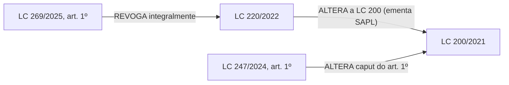

# Demo Jurix para reunião PIBIC/PGM — 13/10/2026

## Objetivo e status honesto

Demo de pesquisa/protótipo, não ferramenta pronta para uso em processo real. Runtime QA atual: `http://127.0.0.1:8292`. O web QA responde saudável. O fluxo de resposta fundamentada e abertura do PDF local foi exercitado. A tela de grafo abre, mas reporta **0 normas disponíveis**: há normas e eventos no banco QA, porém nenhuma norma é elegível para o catálogo do grafo após excluir fixtures sintéticas e registros não consolidados. Portanto, não apresentar um grafo de relações reais como saída atual do Jurix.

O que pode ser demonstrado como funcional:

1. Pergunta sobre norma presente no arquivo local → recuperação de trecho → citação ligada ao dispositivo → abertura da página do PDF.
2. Pergunta cuja evidência não está disponível → abstenção em vez de inventar vínculo ou conclusão.
3. Tela de grafo com a regra explícita de que afinidade temática não equivale a alteração, revogação ou vigência; estado vazio é real e deve ser mostrado como limitação do corpus.

## Caso PGM realista para discussão

> Em processo de análise de contratação de operação de crédito do Município, qual é a cadeia documental entre as Leis Complementares municipais nº 200/2021, nº 220/2022 e nº 269/2025? Identifique somente relações expressamente demonstradas pelos atos oficiais, mostre o dispositivo que revoga a LC nº 220 e as alterações posteriores do art. 1º da LC nº 200. O acervo permite reconstruir a redação aplicável na data do processo? Se não, indique precisamente a evidência ausente; não infira repristinação nem conclusão sobre a autorização.

É uma pergunta de triagem jurídica, não pedido para o modelo decidir validade da contratação. Ela testa identidade normativa, eventos `ALTERA`/`REVOGA`, ordenação temporal, fontes primárias, limite de evidência e abstenção.

## Mapa documental conferido em fontes oficiais

O diagrama é uma síntese manual dos textos oficiais para conduzir a conversa; **não foi produzido pelo grafo do Jurix** e ainda não foi adjudicado por procurador. A LC 260/2025 não pertence a essa cadeia: trata de alteração no art. 121 da Lei nº 1.517/1965, relativa ao limite de consignações em folha ([SAPL — listagem de matérias](https://sapl.natal.rn.leg.br/materia/pesquisar-materia?ano=2025&materiaassunto_null=true&page=30)). O ato que propõe nova redação ao caput do Art. 1º da LC 200 é o PLC 5/2025 (mensagem 95/2025); a ficha SAPL consultada registra que ele aguardava apreciação em 04/08/2026, portanto não deve aparecer como alteração promulgada ([mesma listagem oficial](https://sapl.natal.rn.leg.br/materia/pesquisar-materia?ano=2025&materiaassunto_null=true&page=30)).

O recorte do Art. 260 da LC 258 enumera seis atos e um dispositivo específico como alvos expressos. A mesma lei também contém no Art. 266 a fórmula genérica “revogadas as disposições em contrário”, que não identifica alvos adicionais por si só; e o Art. 261 altera o Art. 14 da LC 208, relação de alteração, não de revogação. A prévia visual da rota `/explorar/demo-consolidacao/` representa as sete referências do Art. 260 e exibe esses dois outros eventos separadamente.

Fontes oficiais para abrir durante a reunião:

- [SAPL — LC 269/2025, identificação e ementa](https://sapl.natal.rn.leg.br/norma/8946)
- [Diário Oficial do Município — edição extra de 25/11/2025, LC 269/2025](https://natal.rn.gov.br/storage/app/media/DOM/anexos/dom_20251125_extra_0f39024beb19c20cb54e8bdea69a370e.pdf). O art. 1º diz que a LC 220/2022 é revogada integralmente; o art. 2º põe a lei em vigor na publicação.
- [SAPL — LC 220/2022, identificação e ementa](https://sapl.natal.rn.leg.br/norma/1598)
- [SAPL — LC 247/2024](https://sapl.natal.rn.leg.br/norma/3673)
- [SAPL — pesquisa legislativa, PLC 5/2025 e situação registrada em 04/08/2026](https://sapl.natal.rn.leg.br/materia/pesquisar-materia?ano=2025&materiaassunto_null=true&page=30)
- [SAPL — LC 258/2024 e PDF oficial](https://sapl.natal.rn.leg.br/norma/4052)
- [PDF oficial da LC 258/2024](https://sapl.natal.rn.leg.br/media/sapl/public/normajuridica/2024/4052/lei_complementar_no_258_2024.pdf)

Na inspeção visual ao vivo, as páginas HTML oficiais do SAPL para LC 269/2025 (`/norma/8946`), LC 220/2022 (`/norma/1598`) e LC 247/2024 (`/norma/3673`) abriram e confirmaram datas/ementas. A seção “Normas Relacionadas” dessas páginas não apresentou vínculos estruturados, embora as ementas textuais descrevam a relação — evidência concreta de que o Jurix não pode depender apenas do campo estruturado do catálogo. O PDF externo do DOM ficou em branco no visualizador embutido durante esta sessão; para apresentação, prefira abrir primeiro a página HTML do SAPL e deixe o PDF do DOM como fonte complementar.

## Roteiro de 5–7 minutos

1. **Abrir o produto:** `http://127.0.0.1:8292/assistente/?corpus=archive-qa`. Informar que é QA isolado e que o banner do acervo é parte importante do resultado, não uma nota de rodapé.
2. **Mostrar recuperação auditável:** a consulta já executada foi “Em um processo de licenciamento urbanístico e ambiental de imóvel em Natal, qual é o objeto da Lei Complementar nº 258/2024 e o que estabelece o art. 1º? Cite somente os dispositivos sustentados pelas fontes recuperadas.” Resultado: o Jurix recuperou o Art. 1º, vinculou a citação à LC 258/2024, exibiu uma evidência e abriu o PDF arquivado diretamente na página 1. A tela alerta que a transcrição e os metadados continuam em revisão e que a pesquisa SAPL não confirmou associação; logo, a resposta não certifica completude/vigência.
   - Para localizar o mesmo PDF começando pela biblioteca, use **Pesquisa jurídica** (`http://127.0.0.1:8292/pesquisa/?q=258%2F2024`): ela retorna 1 documento candidato, com status pendente, e abre a ficha/PDF. **Não use `/normas/?q=258%2F2024` como prova de que o arquivo não existe**: essa tela mostra 0 normas consolidadas; o filtro de candidatos cobre somente os 40 da página atual. Essa diferença foi reproduzida no browser em 13/10 e é uma lacuna de descoberta/usabilidade da biblioteca, não ausência do PDF.
3. **Mostrar revogação e regra de transição no próprio assistente (fluxo testado):** pergunte “Estou conferindo uma fundamentação antiga que usa o Art. 21 da Lei Complementar nº 55/2004. A LC 258/2024 menciona esse artigo? Considere também o Art. 260, inciso IV, e o Art. 262. Explique o que cada dispositivo informa e o que falta confirmar antes de usar isso em um processo concreto.” O QA recuperou LC 258/2024, Arts. 260 e 262, e LC 55/2004, Art. 21. A resposta explica que a LC 258 lista a LC 55 entre os atos revogados e descreve a regra transitória, mas não afirma que o Art. 21 continua vigente nem decide o caso. Abra “Ver fontes” e os PDFs nos trechos citados. **Os PDFs são candidatos com extração pendente de revisão humana**: mostre rastreabilidade e limite de evidência, não parecer ou redação certificada.
4. **Mostrar a barreira contra alucinação:** a pergunta de cadeia LC 200/220/269 não encontrou trechos locais suficientes e o assistente não associou fontes. Explique que isso impede uma conclusão inventada, mas também revela que essa cadeia ainda não foi carregada no corpus do produto.
5. **Mostrar o grafo no produto:** abrir `http://127.0.0.1:8292/explorar/`. A tela apresenta 0 normas consolidadas disponíveis e explica que itens pendentes/temáticos não são promovidos a relações jurídicas. Não simular clique em nós que não existem.
6. **Mostrar a oportunidade de pesquisa:** abrir as fontes oficiais acima e comparar a ementa, o art. 1º da LC 269 e as alterações posteriores do art. 1º da LC 200. Apresentar o Mermaid deste documento como mapa documental manual, não como resultado do app.
7. **Fechar com próximo experimento:** cadastrar/importar as quatro leis promulgadas (LC 200, 220, 247 e 269) e, separadamente, o PLC 5/2025 como proposição ainda não promulgada; extrair candidatos com citação precisa; confirmar identidade/dispositivo/data e sentido de cada relação com revisão humana; então testar se a interface exibe a cadeia e se o RAG responde à pergunta em datas D-1/D/D+1. Medir precisão das relações, cobertura das citações e taxa de abstenção. Não promover a resposta para uso profissional antes de revisão da PGM.

## Evidência local executada em 13/10/2026

- `GET /api/v1/health/live/` em `:8292`: HTTP 200.
- Browser real: assistente respondeu à pergunta da LC 258/2024; renderizou link de citação e painel “Fontes Consultadas (1)”. A evidência identificou Art. 1º e descreveu a contribuição como trecho do PDF, com revisão pendente. “Abrir PDF do acervo” abriu `/normas/documentos/eaa13513-6cfc-4edf-8027-c6a7cc6d70b7/pdf/#page=1`; o visualizador exibiu a LC 258/2024, página 1/99, com o Art. 1º visível.
- A pergunta de cadeia LC 200/220/269 terminou em abstenção por insuficiência de evidência local; resultado visto no browser.
- Abri em browser real as páginas oficiais SAPL da LC 269/2025, LC 220/2022 e LC 247/2024; metadados/ementas foram visíveis. “Normas Relacionadas” não mostrou vínculos estruturados nessas telas, apesar das ementas descreverem relações. O PDF externo do DOM não renderizou no browser embutido e não deve ser o único caminho visual da demo.
- `/explorar/` em browser real: “0 normas”; texto informa que apenas registros consolidados/revisados entram no grafo. Consulta read-only ao banco QA: 74 registros `Norma`, 22 eventos, 11 eventos com `validado=True`, 1 norma com `status=consolidated`, **0 normas elegíveis** após regra `consolidated_normas_for_product()` que exclui `identity_json.synthetic_fixture=True`. Não alterar esse gate para fazer a demo parecer completa.
- O banco usado foi o PostgreSQL de auditoria `jurix_audit`; não foi feita escrita jurídica, importação, revisão, promoção, consolidação ou alteração no banco do produto.

## Reexecução do roteiro — browser automatizado — 13/10/2026

- Reexecutei `tests/js/pgm-workflow-smoke.mjs` contra `http://127.0.0.1:8292`, usando apenas o banco e armazenamento isolados de QA. Resultado: **21 verificações passaram, 0 falhas**; cobre assistente, busca no acervo, ficha/PDF, drawer de fontes, exportação, pergunta de relação, abstenção temporal, fluxo de revogação/transição em PDFs reais pendentes, fonte pública SAPL, acesso anônimo e viewports 320/360/640/768/1280/1920 px.
- O smoke só concluiu após habilitar a opção documentada de checkout local sem versão. A identidade exibida foi **“build local não identificado”**; portanto a execução valida este runtime QA, não uma release identificada. Relatório sanitizado e screenshots desta reexecução ficaram no diretório temporário QA `C:\Users\CAUV~1\AppData\Local\Temp\jurix-pgm-goal-qa-20261008\pgm-demo-retest-20261013-b\pgm-workflow-smoke.json`.
- Verificação manual adicional: `/normas/?q=258/2024` mostrou 0 consolidadas e 0 correspondências entre os 40 itens da página atual; `/pesquisa/?q=258/2024` encontrou 1 PDF candidato, a ficha abriu HTTP 200 e apontou para o PDF arquivado. Isso confirma o roteiro corrigido acima e identifica a descoberta na tela `/normas/` como ponto de confusão. O grafo continua corretamente vazio; não é demo de grafo funcional.

## Mensagem curta para o orientador

“Já consigo demonstrar recuperação de PDF com citação local e abstenção quando falta evidência. O grafo de produto ainda está vazio porque não há normas reais elegíveis consolidadas, mas preparei uma prévia QA da LC 258/2024, baseada no texto extraído do PDF candidato: ela mostra sete referências expressas do Art. 260, a alteração do Art. 261 e a cláusula genérica do Art. 266 sem inventar alvos. A prévia é rastreável, mas segue pendente de revisão jurídica e não certifica efeitos. O próximo passo é validar relações e redações com revisão humana e medir se a consulta temporal evita citar texto superado. Ainda é um protótipo de pesquisa, não uma ferramenta pronta para uso processual.”

## Atualização da prévia de grafo por caso — 13/10/2026

Foi adicionada em uma instância QA separada a rota `/explorar/demo-consolidacao/`, alcançável pelo CTA em `/explorar/`. A visualização desenha as **sete referências** extraídas literalmente do Art. 260 (seis atos e um dispositivo específico) como nós ligados à LC 258/2024 por uma relação central “Ficam revogados”. A legenda separa PDF candidato, conflito de identidade e PDF ausente; em telas menores, os alvos passam para uma coluna com as conexões mantidas. O acervo QA tem um PDF candidato com identidade correspondente à LC 55/2004 (cópia consolidada de julho de 2019, extração 7056) e um candidato LC 198/2021 cujo tipo diverge da citação “Lei nº 198/2021”. Os outros cinco alvos não têm PDF correspondente nesse lote QA. A LC 258/2024 está na página 60; o link do candidato LC 55 abre o PDF para cotejo. A prévia também apresenta em blocos separados o Art. 261 (alteração da LC 208/2022) e o Art. 266 (cláusula geral sem alvos individualizados), para não misturar os dois com as arestas explícitas do Art. 260.

Esta não é uma consolidação nem uma aresta persistida no grafo de produto. A extração da LC 258 está completa, mas há **zero dispositivos estruturados** nela; identidade/edição, alcance, vigência e relações dependem de cotejo e revisão jurídica. O conflito entre Lei e Lei Complementar nº 198 é deliberadamente mostrado sem associação automática. O CTA e a rota são habilitados somente por flag no perfil de desenvolvimento QA; a configuração padrão mantém a rota indisponível. A página informa que não houve gravação ou promoção. O grafo público em `/explorar/` continua com zero normas elegíveis — a prévia não altera esse resultado.

Para mostrar ao orientador, abrir `http://127.0.0.1:8291/explorar/demo-consolidacao/`, mostrar os sete nós e a cobertura desigual do acervo, abrir o PDF da LC 258 e inspecionar a cópia candidata da LC 55. Descrever como protótipo de referências extraídas → declaração textual → checagem de identidade → lacunas/conflito → revisão humana pendente; não apresentar as arestas como relações já persistidas ou efeitos jurídicos adjudicados. A LC 258/2024, Art. 262, é uma pista de transição para formular a pergunta processual, não uma conclusão sem datas e histórico oficiais. A instância `:8293` pode continuar servindo HTML antigo sem recarga; `:8291` foi iniciada do checkout atual para validar esta revisão.

Screenshot do grafo QA em viewport desktop: [`pgm-lc258-art260-graph-20261013.png`](screenshots/pgm-lc258-art260-graph-20261013.png). O teste Chromium confirmou HTTP 200, sete nós, legenda e nó da relação em 320, 360, 768, 1280 e 1920 px, sem overflow horizontal; isso não substitui teste de acessibilidade assistiva nem revisão jurídica.

Regressão de reconciliação P-009: acrescentei cenário técnico em que um evento `REVOGA` inicialmente sem alvo passa a encontrar uma identidade única. A resolução atualiza vínculo/proveniência como `resolved_unreviewed`, mantendo `validado=False` e revisão pendente. A suíte combinada de reconciliação, referências e evidência passou com **43 testes**; Ruff e `manage.py check` no perfil QA passaram. Este cenário é fixture sintética de contrato: não adjudica as sete referências reais da LC 258 nem fecha P-009.

Roteiro browser PGM reexecutado no checkout atual em `:8291`: status geral `passed`, **20 checks aprovados, zero falhas e 1 condição esperada** (`build-and-corpus-disclosure = unversioned-local-checkout`); 13 capturas. Cobriu busca/responsividade, PDF real, fontes/teclado, exportação, abstenção temporal, LC 258 (revogação/transição), proposta SAPL e gate anônimo da mesa de revisão. Relatório sanitizado: `%TEMP%\jurix-pgm-goal-qa-20261008\pgm-workflow-smoke-current-20261013\pgm-workflow-smoke.json`. Sessões criadas somente no banco QA isolado. Como o checkout está sujo e o build não identifica revisão, o resultado é evidência do runtime deste teste, não de uma release reproduzível nem de adjudicação por procurador.

### Iteração de legibilidade do grafo — 13/10/2026

Após inspeção visual da captura r15, as ligações do Art. 260 cruzavam outros cartões. No desktop, reorganizei os sete alvos expressos em duas colunas sob o nó do Art. 260 e mantive os eventos dos Arts. 261 e 266 em trilhas próprias; os conectores repetidos agora se alinham às colunas para reduzir cruzamentos. Em larguras até 920 px, o mapa volta ao fluxo responsivo sem posicionamento fixo. A captura r18 está em `%TEMP%\jurix-pgm-goal-qa-20261008\pgm-lc258-network-20261013-r18\pgm-lc258-repeal-graph-1280px.png`.

Verificações r18: smoke integral `tests/js/pgm-workflow-smoke.mjs` em `:8291`, **24 checks passados, zero falhas e zero page errors**; o teste mantém 12 arestas, sete alvos nomeados, Art. 261/266 separados e responsividade de 320 a 1920 px. `src/tests/test_workspace_routes.py`: **67 passed, 1 skipped**; `node --check` nos arquivos JS alterados e `git diff --check` passaram. Isso valida layout e contratos de interface no QA, não a correção dos efeitos jurídicos.

### Pesquisa global mais encontrável — 13/10/2026

Após o relato de que a LC 258 não era encontrada em `/normas/`, constatei que o filtro local analisava só os 40 cartões da página, enquanto a rota global `/pesquisa/` já encontrava o PDF entre os 6.664 candidatos. Coloquei o atalho para a pesquisa integral junto aos filtros principais, preservando o termo e explicando que os arquivos seguem pendentes de revisão. O smoke r20 confirmou CTA visível sem rolar a página, navegação HTTP 200 e resultado da LC 258 com rótulo de candidato/ressalva. Captura do primeiro viewport: `%TEMP%\jurix-pgm-goal-qa-20261008\pgm-p011-archive-bridge-20261013-r20\pgm-normas-global-search-bridge-1280px.png`; JSON do smoke no mesmo diretório. Não houve aceite ou consolidação; P-011 permanece parcial pelos filtros/qualidade global ainda faltantes.

### Revisão do mapa LC 258 — 13/10/2026

A conferência direta do [PDF oficial no SAPL](https://sapl.natal.rn.leg.br/media/sapl/public/normajuridica/2024/4052/lei_complementar_no_258_2024.pdf), p. 59–60 do documento (página impressa 60), confirma que o Art. 260 lista **seis atos e um dispositivo específico (Art. 21 da Lei Promulgada nº 275/2009)**. O Art. 261 altera o Art. 14 da LC 208/2022; o Art. 266 traz uma cláusula geral “revogadas as disposições em contrário”, sem individualizar outros alvos. A página QA passou a desenhar as sete referências do Art. 260 e a exibir Art. 261/266 em blocos próprios, sem gerar arestas nominais para a cláusula genérica.

Também foi corrigido um erro no roteiro anterior: a LC 260/2025 não alterou a LC 200/2021. O SAPL registra essa LC 260 como alteração do art. 121 da Lei 1.517/1965. A proposição sobre a LC 200 é PLC 5/2025, e a listagem oficial ainda a mostrava aguardando apreciação em 04/08/2026; ela não é desenhada como lei promulgada. Fontes: [ficha oficial da LC 258](https://sapl.natal.rn.leg.br/norma/4052), [listagem SAPL com PLC 5/2025 e LC 260/2025](https://sapl.natal.rn.leg.br/materia/pesquisar-materia?ano=2025&materiaassunto_null=true&page=30).

Validação após a atualização: a instância QA atual em `http://127.0.0.1:8291/explorar/demo-consolidacao/` respondeu HTTP 200, renderizou sete nós, identificou corretamente “seis atos e um dispositivo”, mostrou os cartões Art. 261/266 e carregou o CSS `jurix-pgm-demo.css?v=20261013-4`. O teste automatizado `src/tests/test_workspace_routes.py` passou (**66 passed, 1 skipped**); Ruff nos módulos da rota passou e `manage.py check` reportou zero problemas. A instância antiga `:8293` continua sem reinicialização e pode mostrar o HTML anterior.

P-010 continua **parcial**: há contratos automatizados D−1/D/D+1 e bloqueio de projeção incompleta, mas esses testes usam cenários sintéticos. O PDF real da LC 258 no QA segue pendente, com zero dispositivos estruturados, e não pode alimentar projeção temporal revisada. Não há ainda cadeia real com original, eventos, dispositivos, datas e decisões humanas suficiente para afirmar reconstrução histórica aplicada a processo.

Como avanço incremental de P-010, a política temporal reconhece agora a forma literal do Art. 266 (“entra em vigor 90 (noventa) dias após a data de sua publicação”) e sugere **27/03/2025** a partir da publicação SAPL de 27/12/2024, com base na contagem do [Art. 8º, §1º, da LC 95/1998](https://www2.camara.leg.br/legin/fed/leicom/1998/leicomplementar-95-26-fevereiro-1998-363948-normaatualizada-pl.html). O sistema retorna `candidate`, guarda a citação literal/regra/base e `operative=False`; sem data de publicação retorna `unknown`. É um contrato de cálculo em wrapper de teste, não revisão jurídica da LC 258 nem aplicação a processo. `test_event_temporal_policy.py`, `test_normative_projection.py` e `test_real_chain_projection_contract.py`: **19 testes passaram**. `src/apps/legislation/event_review.py` usa essa decisão para preencher a data inicial do formulário de revisão; aprovação e registro separados continuam obrigatórios antes de projeção.

### Atualização visual da prévia de relações — 13/10/2026

A rota QA atualmente verificada é `http://127.0.0.1:8291/explorar/demo-consolidacao/`. O mapa reúne a LC 258/2024, três nós de evento (Arts. 260, 261 e 266) e nove destinos: sete referências expressas, LC 208/2022, Art. 14, e a categoria “disposições em contrário”, sem associar leis por inferência. O browser confirmou 12 arestas dirigidas, sete alvos expressos e os dois eventos adicionais em 320, 360, 768, 1280 e 1920 CSS px, sem overflow ou erros de página. A captura final está em `%TEMP%\jurix-pgm-goal-qa-20261008\pgm-lc258-network-20261013-r15\pgm-lc258-repeal-graph-1280px.png`.

`/explorar/` continua sendo o grafo de produto e permanece vazio no QA; a rota acima é uma demonstração por caso, não uma projeção persistida/consolidada. As arestas indicam conteúdo textual observado, não efeito jurídico validado. O health QA mais recente mantém SAPL `degraded`: um escopo sem sincronização concluída (contado como parcial e não inicializado) e zero full sweeps. O endpoint SAPL respondeu a uma amostra GET limitada de 40 IDs; não houve sync ou escrita para alterar esse estado.

### Busca global do acervo — 13/10/2026

O atalho da página `/normas/` preserva agora espécie/ano escolhidos e leva para a busca integral de PDFs. A página de pesquisa exibe os filtros ativos de forma persistente e acessível. Smoke QA r22: 24 checks aprovados, um aviso informativo de checkout local não versionado e zero erros de página; 88 testes Python passaram e 1 foi ignorado. O candidato LC 258/2024 foi encontrado sob os filtros Lei Complementar/2024, permanecendo explicitamente pendente de revisão. Evidências sanitizadas: `%TEMP%\jurix-pgm-goal-qa-20261008\pgm-p011-filter-summary-20261013-r22\`. Isso melhora a descoberta, não consolida os PDFs nem valida efeitos jurídicos.
